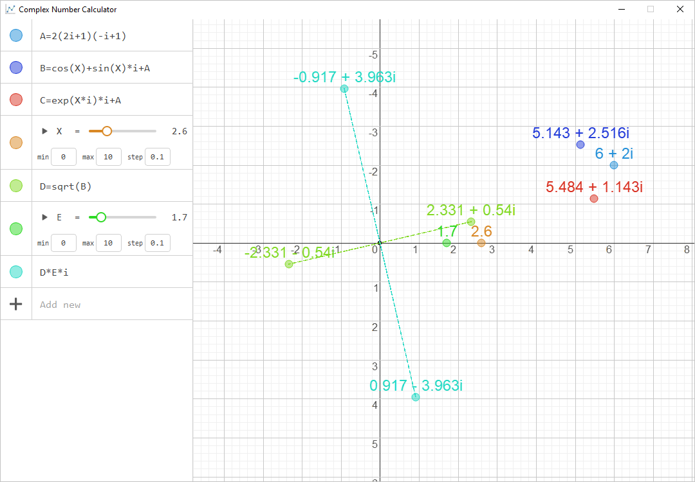
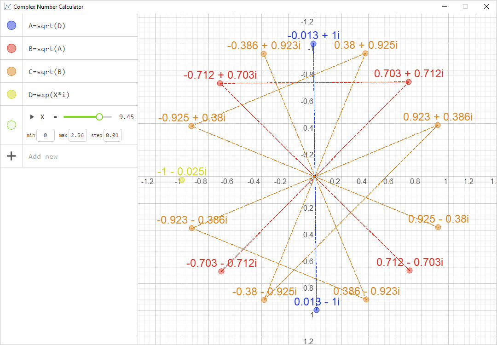

<style>
* {
	box-sizing: border-box !important;
}

:root {
	--text-color: white;
	--background-color: transparent;
}

.center {
	display: block;
	margin: 0 auto;
	text-align: center;
}

.katex-display {
	padding: 5px 0;
}

.katex-display .newline {
	margin-top: 15px;
}

img {
	padding: 10px;
}

/* h1 {
	margin-top: 0 !important;
	font-size: 1.7em !important;
}

h2 {
	margin-top: 0.3em !important;
	font-size: 1.2em !important;
}

h3 {
	margin-top: 2em !important;
}

h4 {
	margin-top: 1.5em !important;
} */

h1,
h2,
h3,
h4 {
	margin-bottom: 6px !important;
}

.figure-list {
	display: flex;
	flex-direction: row;
	flex-wrap: wrap;
	justify-content: center;
	align-items: flex-start;
}

figure {
	flex: 1;
	display: flex !important;
	flex-direction: column;
	align-items: center;
	text-align: center;
	/* max-width: 30vw !important; */
	margin-top: 5px !important;
	margin-bottom: 20px !important;
}

figure img {
	/* max-width: 580px !important; */
	min-width: 350px;
}

figure pre {
	text-align: start;
}

figure figcaption {
	font-size: 13px;
	opacity: 0.9;
}

figure figcaption > p {
	display: inline;
}

body {
	counter-reset: figures tables;
}

figure:not(:has(> table)) figcaption {
	counter-increment: figures;
}

figure:not(:has(> table)) figcaption:before {
	content: 'Figure ' counter(figures) ': ';
}

figure:has(> table) figcaption {
	counter-increment: tables;
}

figure:has(> table) figcaption:before {
	content: 'Table ' counter(tables) ': ';
}

figure table {
	margin: 0 auto;
	max-width: 100%;
}

.markdown-body table td {
	text-align: initial !important;
}

@media print {
	body {
		border: 10mm solid var(--background-color);
	}
}

@media print {
	.pagebreak {
		break-after: page;
	}
}

/* DO NOT REMOVE! */
@page {
	size: A4 portait;
	margin: -37px !important;
}

/* .h1 {
	font-size: 38px;
	font-weight: 600;
}

.h2 {
	font-size: 24px;
}

.h3 {
	font-size: 18px;
} */

.markdown-body {
	font-size: 13px;
	/* padding: 40px 40px !important; */
	/* padding: 120px 120px 100px 120px !important; */
}

.markdown-body p:not(:last-child) {
	margin-bottom: 14px !important;
}

/* .markdown-body table td,
.markdown-body table th {
	padding: 0.1em 1.0em;
	vertical-align: middle;
	text-align: center;
} */

.markdown-body table th {
	/* font-weight: 400; */
}

/* table {
	margin: 0 auto 16px auto;
}

table tbody tr>td:first-child {
	font-weight: 600;
	text-align: left;
} */

/* img {
	margin-top: -10px;
	margin-bottom: -10px;
} */

table tbody tr>td:first-child,
table tbody tr>td:first-child > * {
	/* white-space: nowrap; */
	line-break: anywhere;
}

table {
	font-size: 0.8em;
}

figure > pre {
	max-width: fit-content;
}

.markdown-body table td, .markdown-body table th {
    padding: 6px 13px !important;
	/* font-size: 0.85em; */
}

.figure-list figure {
	font-size: 0.85em;
}

.markdown-body hr {
	display: none;
}

.markdown-body p+p {
	text-indent: 0 !important;
}

.markdown-alert p{
    text-align: initial !important;
}
</style>

# BPC-PP2 2026/2027, Project 1 - Technical Report

* **Topic:** Complex-number expression evaluator and plotter.
* **Authors:** Bc. Jaroslav Louma *&lt;xlouma00@stud.fit.vutbr.cz&gt;*
* **Date:** 2021-06-25, 2026-11-17
* **Version:** 2.0

A small PyQt5 desktop app for evaluating **complex-number expressions** and
plotting the results on the complex plane. Each row in the left sidebar is an
expression (or an animated slider); the right-hand canvas draws the results as
labelled points. Expressions can reference each other, and multi-valued
results (e.g. `sqrt(-1)`) are drawn as several points joined by a dashed line.

<div class="figure-list">
<figure>

<figcaption>

Screenshot showcasing the app's main window, with a few expressions and sliders defined.

</figcaption>
</figure>
<figure>

<figcaption>
	
Screenshot showcasing expressions with multi-valued results (2, 4 and 8-th roots of complex exponential).

</figcaption>
</figure>
</div>

- **Left (sidebar):** the list of named expressions and sliders.
- **Right (canvas):** the complex plane with a grid, labelled axes and the
  plotted values, colored to match each row.

## Requirements

- Python 3.x (developed against 3.12)
- **PyQt5** (the only third-party dependency)

```sh
pip install PyQt5
```

## Running

```sh
python main.py
```

The window is a fixed 1080x720 (see `style.qss` for sizing and colors).

## Usage

### Expressions

Type an expression into any row and press **Enter**. Complex literals use `i`
as the imaginary unit.

* $3+2i$
* $1-4i$
* $5$
* $2(1+i)$

Operators and their precedence:

<figure>

| Operator  | Meaning                    | Notes                                                  |
| --------- | -------------------------- | ------------------------------------------------------ |
| `^`, `**` | power                      | right-associative, tighter than unary                  |
| unary `-` | negation                   | lower precedence than `^` (so `-2^2` is `-(2^2) = -4`) |
| `*`, `/`  | multiply / divide          | left-associative                                       |
| `+`, `-`  | add / subtract             | left-associative                                       |
| `\|x\|`   | magnitude / absolute value | same as `abs(x)`                                       |

<figcaption>

List of operations defined by the specific operators + their precedence and associativity.

</figcaption>
</figure>


Implicit multiplication is supported, so `2i`, `2(1+i)` and `3x` all work.

Built-in constants: `i` (the imaginary unit), `pi`, `e`.

### Named variables

Prefix a row with `name =` to define a variable and reference it in later rows:

```
a = 3+2i
b = a*2      -> 6 + 4i
c = b/a      -> 2
```

The dependency graph is evaluated in topological order. If a dependency is
invalid (or a row has a parse/eval error), every row that depends on it is
marked with a warning icon, so breakage propagates down the chain.

### Sliders

Click the **"+" (Add new)** row's icon to open a type menu and pick
**Slider** instead of a plain expression. A slider row has:

- an **editable id**,
- a draggable value with **min / max / step** fields, and
- a **play/pause** button that animates the value (one step per tick,
  bouncing between the bounds - ping-pong).

The slider's value is a normal variable you can reference in other rows.
Defaults are `0` to `10` in steps of `0.1` (configurable in `style.qss`).

### Functions

<figure>

| Function               | Args   | Description                                  |
| ---------------------- | ------ | -------------------------------------------- |
| `exp`                  | 1      | e^x                                          |
| `sin`, `cos`, `tan`    | 1      | trigonometric                                |
| `sinh`, `cosh`, `tanh` | 1      | hyperbolic trigonometric                     |
| `asin`, `acos`, `atan` | 1      | inverse trigonometric *(multi-valued)*       |
| `abs`                  | 1      | magnitude                                    |
| `arg`                  | 1      | argument / angle in radians (real)           |
| `conj`                 | 1      | complex conjugate                            |
| `re`                   | 1      | real part (real number)                      |
| `im`                   | 1      | imaginary part (real number)                 |
| `log`                  | 1 or 2 | natural log; `log(x, base)` *(multi-valued)* |
| `log10`                | 1      | base-10 log *(multi-valued)*                 |
| `sqrt`                 | 1      | square root *(multi-valued)*                 |
| `pow`                  | 2      | `x^y` *(multi-valued)*                       |

<figcaption>

List of operations defined as built-in functions + their argument count and description. 

</figcaption>
</figure>

**Multi-valued functions** return every branch at once (capped at
`@maxValues`, 8 by default). For example `sqrt(-1)` yields `-i` and `i`, and
`pow(1, 1/3)` yields all three cube roots. To pick a single branch, use the
`_k` form and pass a branch index as the final argument, e.g.
`sqrt_k(-1, 1)` returns `i` only.

## The canvas

- A grid with helper lines and labelled axes; the origin is marked.
- Each expression is drawn as one or more points colored to match its row; the
  value is printed next to each point.
- Multiple values of a single expression are connected by a dashed line.
- **Zoom** with the mouse wheel, **pan** by dragging.

## Project layout

<figure>

| Path                   | Contents                                                                |
| ---------------------- | ----------------------------------------------------------------------- |
| `main.py`              | entry point                                                             |
| `Calculator.py`        | main window; wires the sidebar and canvas                               |
| `Sidebar.py`           | the left panel: rows, icons, dependency chain, sliders, animation       |
| `Canvas.py`            | the complex-plane plot (grid, axes, points)                             |
| `ExpressionParser.py`  | tokenizer, parser and interpreter (precedence, functions, multi-values) |
| `ComplexNumber.py`     | the complex-number type and math operations                             |
| `CSSPreprocessor.py`   | `@var` preprocessor for `style.qss`                                     |
| `Color.py`, `utils.py` | small helpers                                                           |
| `style.qss`            | styling **and** configuration (see below)                               |
| `resources/`           | SVG icons and the app icon                                              |
| `tests/parser.py`      | test suite for the expression pipeline                                  |
| `pack.sh`              | packaging script                                                        |


<figcaption>

Project layout and file descriptions.

</figcaption>
</figure>

## Configuration

`style.qss` is processed by `CSSPreprocessor`, which supports `@variable`
definitions (`@name = value;`) referenced later as `@name`. Besides plain CSS,
it holds tunable values such as window size, the sidebar width/item height,
slider defaults (`@slider_defaultMin`, `@slider_defaultMax`, `@slider_defaultStep`,
`@sidebar_animInterval`), `@maxValues`, and all canvas colors/zoom/scale.

## Testing

```sh
python tests/parser.py
```

Runs the expression-pipeline test suite (tokenizer, parser, interpreter,
references, pipe syntax, functions and multi-values) - 148 checks.

<hr style="display: block;">

<p>
<span style="float: left; text-align: left;">
<a href="https://work.loumadev.eu/CmplxCalculator/docs/doc.md?theme=light&_s=p" target="_self">https://vut-fit.loumadev.eu/BPC-PP2/projects/01/docs/doc.md</a><br>
Computer Programming 2 (BPC-PP2 26/27Z)
</span>
<span style="float: right; text-align: right;">Bc. Jaroslav Louma (xlouma00)<br>17. November 2026 (C)</span>
</p>